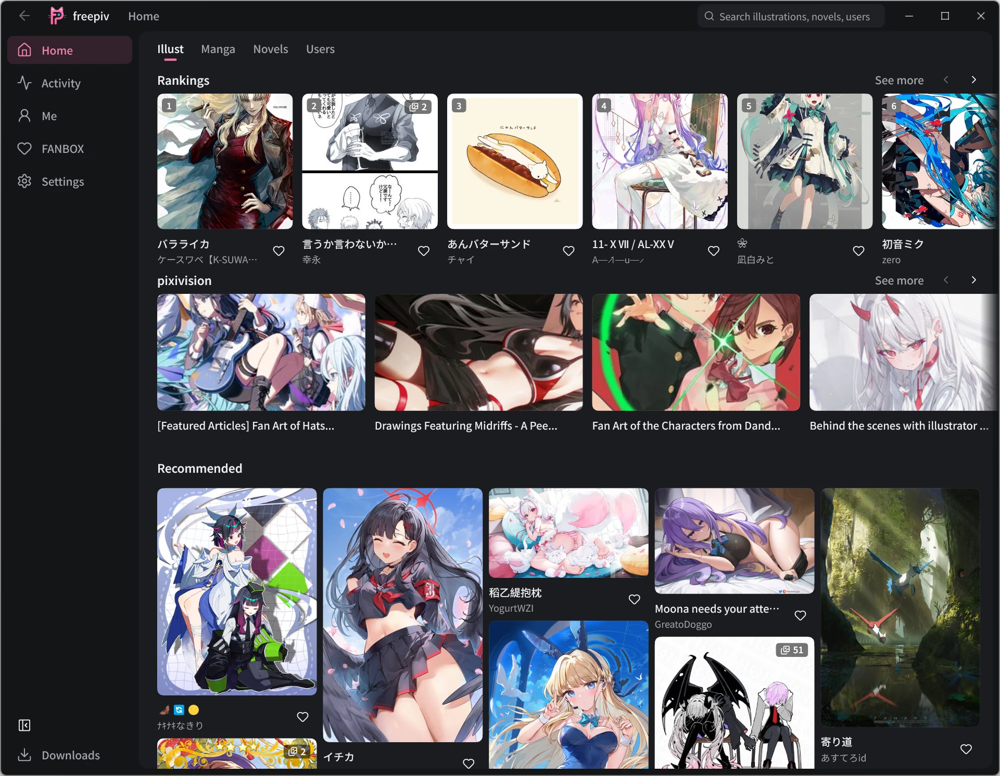
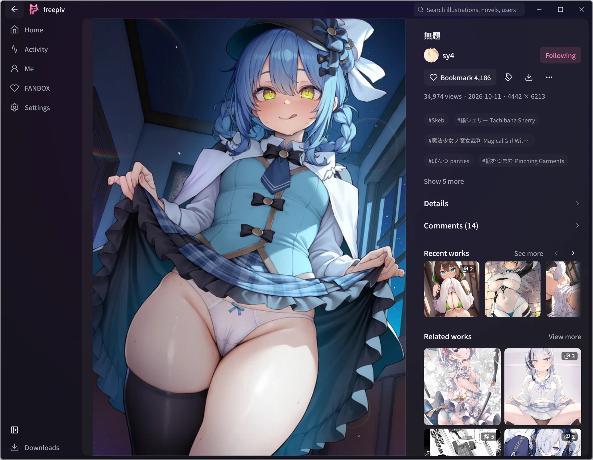
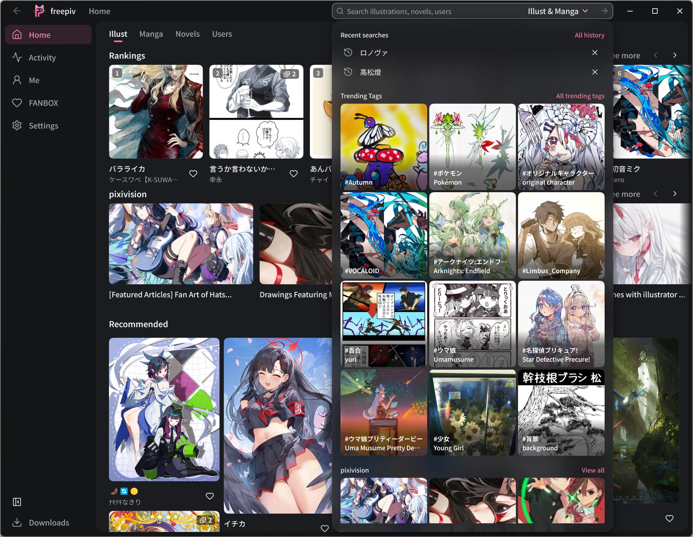
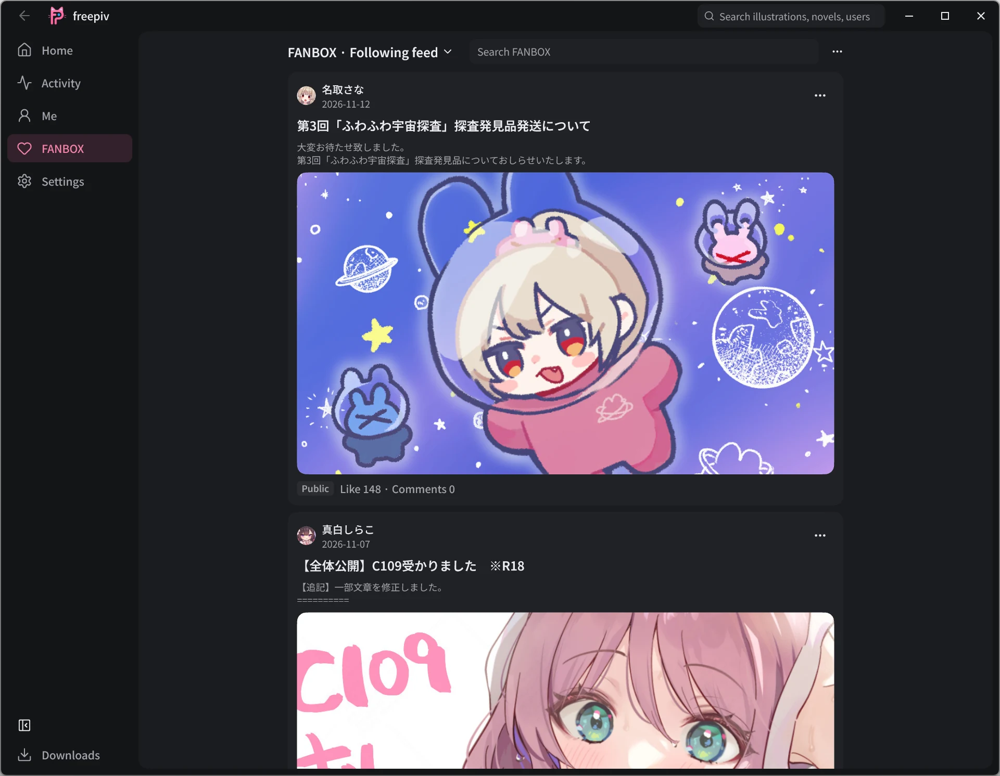
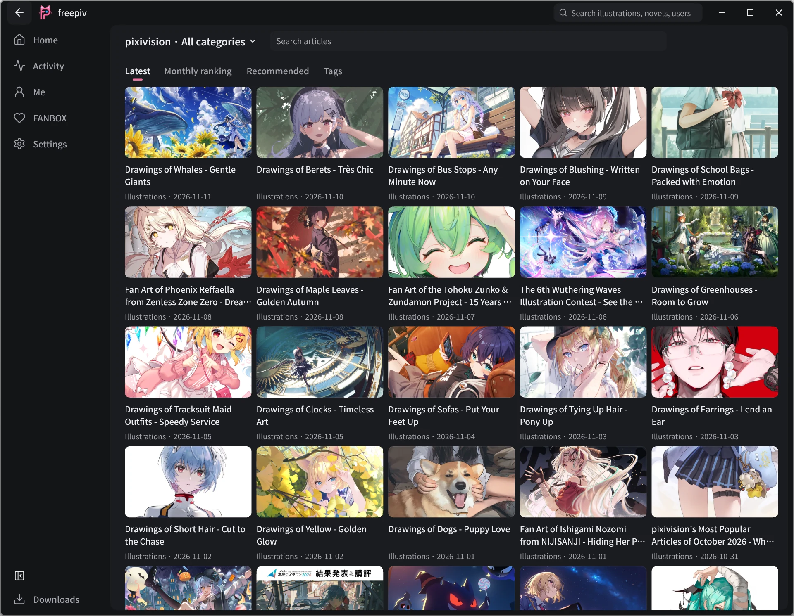
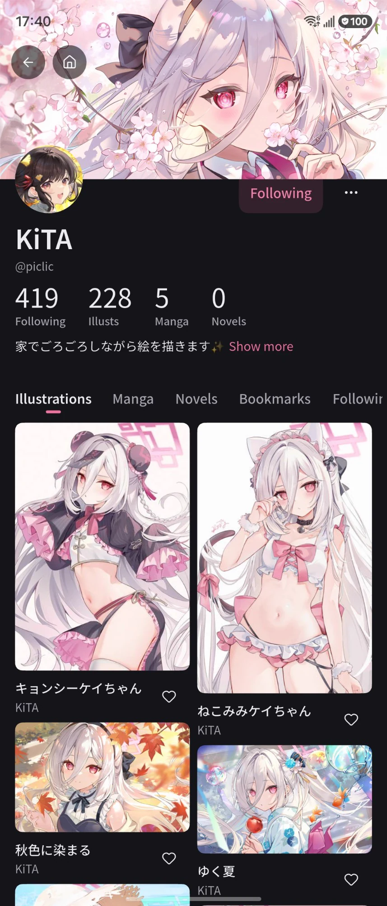
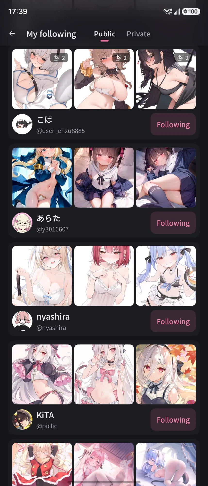

# freepiv

English | [Simplified Chinese](README_zh_cn.md)

**An open-source, cross-platform Pixiv browser with FANBOX and pixivision.**

Browse illustrations and manga, read novels and articles, follow creators, and download artwork on Android, Windows, Linux, macOS, and iOS.

[Download](https://github.com/normalllll/freepiv/releases/latest) | [Features](#features) | [Screenshots](#screenshots)

## Features

- **Pixiv browsing:** Recommendations, rankings, followed creators' updates, illustrations, manga, animated artwork, and novels.
- **Search and discovery:** Search works and users, filter results, browse tags, and revisit recent searches.
- **Your library:** Follow creators publicly or privately, bookmark works with tags, follow series updates, and keep a browsing history on your device.
- **Accounts and filtering:** Switch between several Pixiv accounts, edit your profile and profile image, and hide tags and users you block.
- **FANBOX:** Browse followed and recommended creators, read posts, view creator plans, and download accessible attachments. Paid posts show their required support tier; access follows your FANBOX account's subscriptions.
- **pixivision:** Discover articles by category, tag, or keyword, explore popular articles, and open featured works and creators in the app.
- **Download management:** Track Pixiv and FANBOX tasks in a floating panel, cancel downloads, retry failures, and clear completed tasks. FANBOX files are organized in a separate folder.
- **Desktop and mobile layouts:** Adaptive navigation, mouse-drag scrolling, a custom Windows title bar, themes, and English, Simplified Chinese, Traditional Chinese, and Japanese interfaces.

## Download and install

Download packages from [GitHub Releases](https://github.com/normalllll/freepiv/releases/latest).

| Platform | Package                                                                                                                                                                                                                                                                      | Installation                                                                                                                                                                             |
|----------|------------------------------------------------------------------------------------------------------------------------------------------------------------------------------------------------------------------------------------------------------------------------------|------------------------------------------------------------------------------------------------------------------------------------------------------------------------------------------|
| Android  | [ARM64 APK](https://github.com/normalllll/freepiv/releases/latest/download/app-arm64-v8a-release.apk)                                                                                                                                                                        | Suitable for most current phones. Choose the [universal APK](https://github.com/normalllll/freepiv/releases/latest/download/app-universal-release.apk) if unsure about your architecture |
| Windows  | [windows-x64.zip](https://github.com/normalllll/freepiv/releases/latest/download/windows-x64.zip)                                                                                                                                                                            | Extract the complete archive and run freepiv.exe                                                                                                                                         |
| Linux    | x86_64: [DEB](https://github.com/normalllll/freepiv/releases/latest/download/linux_amd64.deb), [RPM](https://github.com/normalllll/freepiv/releases/latest/download/linux_amd64.rpm), or [tar.gz](https://github.com/normalllll/freepiv/releases/latest/download/linux-amd64.tar.gz) ARM64: [DEB](https://github.com/normalllll/freepiv/releases/latest/download/linux_arm64.deb), [RPM](https://github.com/normalllll/freepiv/releases/latest/download/linux_arm64.rpm), or [tar.gz](https://github.com/normalllll/freepiv/releases/latest/download/linux-arm64.tar.gz) | Built for Ubuntu 24.04 or compatible systems. Choose your distribution's package, or extract the archive and run freepiv |
| macOS    | [Apple Silicon](https://github.com/normalllll/freepiv/releases/latest/download/macos-arm64-nosigned.zip), [Intel](https://github.com/normalllll/freepiv/releases/latest/download/macos-x86_64-nosigned.zip)                                                                  | Extract and move the app to Applications. Builds are not notarized                                                                                                                       |
| iOS      | [ios-nosigned.ipa](https://github.com/normalllll/freepiv/releases/latest/download/ios-nosigned.ipa)                                                                                                                                                                          | Requires your own signing method before installation                                                                                                                                     |

Android ARM32 and x86_64 packages are also available. Check each release's assets and notes for available packages and features.

## Getting started

Sign in to Pixiv to browse your recommendations, follows, and bookmarks. Search from the title bar (on a phone, from the search field on Home), find pixivision on Home, and open **FANBOX** from the sidebar (on a phone, **Me → FANBOX**) for creator posts. FANBOX uses a separate sign-in, managed in Settings.

FANBOX browser sign-in is available on Windows, Android, and iOS. Windows requires WebView2 Runtime; manual cookie sign-in remains available when browser sign-in is unavailable. If content fails to load, check your connection and the app's proxy settings.

## Contributing

Report bugs or suggest features in [Issues](https://github.com/normalllll/freepiv/issues). Include your platform, the affected page, and steps to reproduce. Code, design, and translation contributions are welcome.

## Screenshots

### Desktop

|  |  |
|:------------------------------------------------------:|:--------------------------------------------------:|
|                  Illustration details                  |                  Title bar search                  |
|            |            |
|                      FANBOX feed                       |                     pixivision                     |

### Mobile

|  |  |  |  |
|:------------------------------------------------:|:--------------------------------------------------:|:-----------------------------------------:|:---------------------------------------------:|
|                 Creator profile                  |                 Followed creators                  |                 Rankings                  |                 Novel reader                  |

## License

Licensed under the GNU General Public License v3.0. See [LICENSE](LICENSE).

freepiv is an unofficial client and is not affiliated with or endorsed by pixiv Inc.
