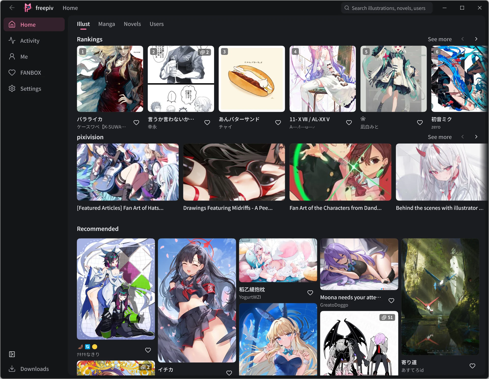
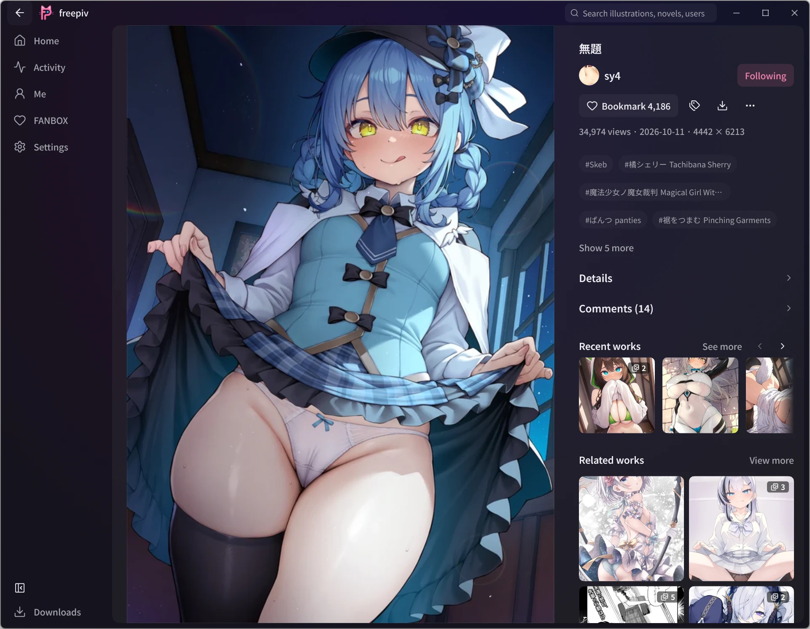
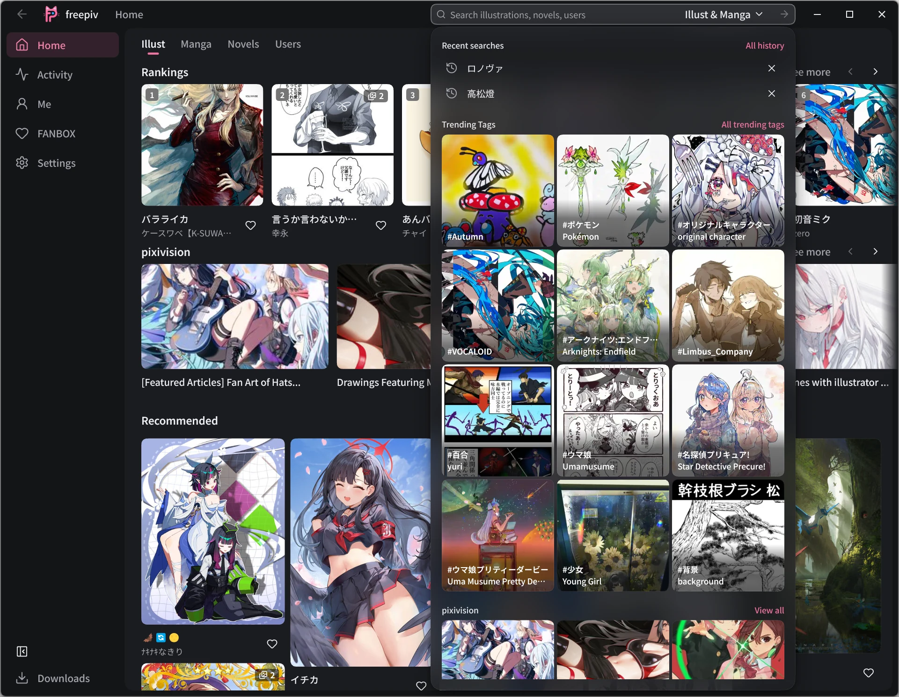
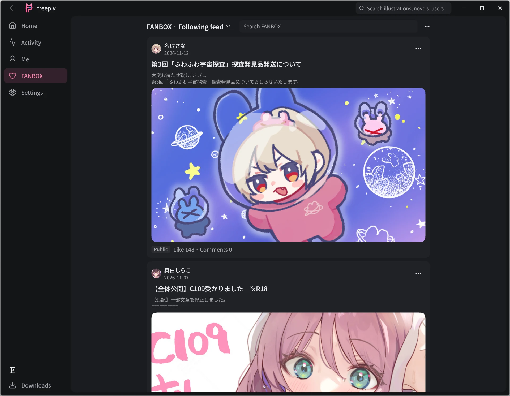
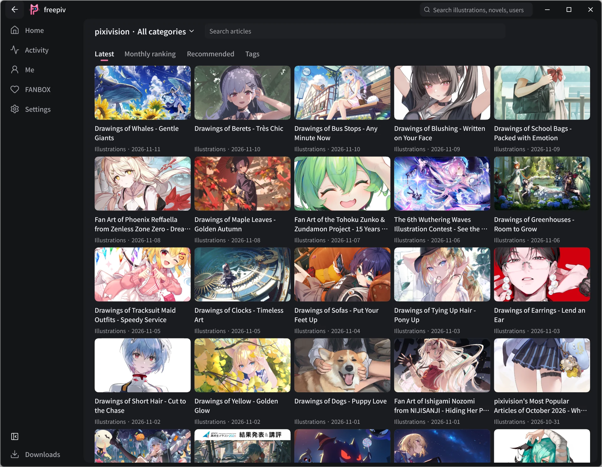
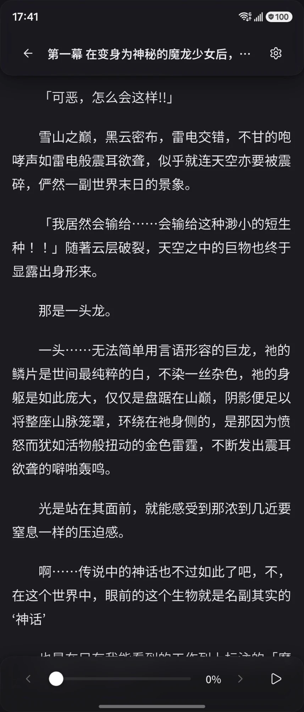

# freepiv

[English](README.md) | 简体中文

**开源的跨平台 Pixiv 客户端，同时支持 FANBOX 和 pixivision。**

在 Android、Windows、Linux、macOS 和 iOS 上浏览插画与漫画、阅读小说和专题文章、关注创作者，并下载喜欢的作品。

[下载最新版](https://github.com/normalllll/freepiv/releases/latest) · [功能](#功能) · [截图](#截图)

## 功能

- **Pixiv 浏览：** 推荐、排行榜、关注动态，以及插画、漫画、动图和小说。
- **搜索与发现：** 搜索作品和用户、筛选结果、浏览标签，并查看最近的搜索记录。
- **个人收藏：** 公开或私密关注创作者、带标签收藏作品、追更系列，并在本机保留浏览记录。
- **账号与屏蔽：** 在多个 Pixiv 账号间切换，编辑个人资料和头像，屏蔽不想看到的标签和用户。
- **FANBOX：** 浏览关注与推荐的创作者、阅读投稿、查看赞助方案，并下载有权访问的附件。付费投稿会显示所需赞助档位，阅读权限取决于 FANBOX 账号的订阅。
- **pixivision：** 按分类、标签或关键词寻找专题文章、浏览热门内容，并在应用内打开文章推荐的作品与作者。
- **下载管理：** 在悬浮面板中查看 Pixiv 与 FANBOX 任务、取消下载、重试失败任务、清空已完成任务。FANBOX 文件单独存放。
- **桌面与移动端布局：** 自适应导航、鼠标拖动滚动、Windows 自定义标题栏、主题，以及简体中文、繁体中文、英语和日语界面。

## 下载与安装

从 [GitHub Releases](https://github.com/normalllll/freepiv/releases/latest) 下载安装包。

| 平台    | 安装包                                                                                                                                                                                                                                                                      | 安装说明                                                                                                                                 |
|---------|-----------------------------------------------------------------------------------------------------------------------------------------------------------------------------------------------------------------------------------------------------------------------------|------------------------------------------------------------------------------------------------------------------------------------------|
| Android | [ARM64 APK](https://github.com/normalllll/freepiv/releases/latest/download/app-arm64-v8a-release.apk)                                                                                                                                                                       | 适合大多数当前手机；不确定架构时选择[通用 APK](https://github.com/normalllll/freepiv/releases/latest/download/app-universal-release.apk) |
| Windows | [windows-x64.zip](https://github.com/normalllll/freepiv/releases/latest/download/windows-x64.zip)                                                                                                                                                                           | 完整解压后运行 freepiv.exe                                                                                                               |
| Linux   | x86_64：[DEB](https://github.com/normalllll/freepiv/releases/latest/download/linux_amd64.deb)、[RPM](https://github.com/normalllll/freepiv/releases/latest/download/linux_amd64.rpm) 或 [tar.gz](https://github.com/normalllll/freepiv/releases/latest/download/linux-amd64.tar.gz) ARM64：[DEB](https://github.com/normalllll/freepiv/releases/latest/download/linux_arm64.deb)、[RPM](https://github.com/normalllll/freepiv/releases/latest/download/linux_arm64.rpm) 或 [tar.gz](https://github.com/normalllll/freepiv/releases/latest/download/linux-arm64.tar.gz) | 面向 Ubuntu 24.04 或兼容系统构建。按发行版选择安装包，或解压后运行 freepiv |
| macOS   | [Apple Silicon](https://github.com/normalllll/freepiv/releases/latest/download/macos-arm64-nosigned.zip)、[Intel](https://github.com/normalllll/freepiv/releases/latest/download/macos-x86_64-nosigned.zip)                                                                 | 解压后移入“应用程序”，应用未经公证                                                                                                       |
| iOS     | [ios-nosigned.ipa](https://github.com/normalllll/freepiv/releases/latest/download/ios-nosigned.ipa)                                                                                                                                                                         | 安装前需要自行签名                                                                                                                       |

Android 另提供 ARM32 和 x86_64 安装包，各版本可用的安装包与功能以发行版附件和说明为准。

## 开始使用

登录 Pixiv 后即可浏览个人推荐、关注和收藏。在标题栏搜索（手机上用首页顶部的搜索框），在首页查看 pixivision，从侧边栏的 **FANBOX**（手机上为**我的 → FANBOX**）进入创作者投稿。FANBOX 使用独立账号登录，可在设置中管理。

Windows、Android 和 iOS 支持 FANBOX 浏览器登录。Windows 需要 WebView2 Runtime；无法使用浏览器登录时，仍可手动填写 Cookie。内容加载失败时，先检查网络连接和应用内的代理设置。

## 参与贡献

欢迎在 [Issues](https://github.com/normalllll/freepiv/issues) 报告问题或提出建议。请提供平台、出现问题的页面和复现步骤。也欢迎贡献代码、设计和翻译。

## 截图

### 桌面端

|  |  |
|:------------------------------------------:|:--------------------------------------------:|
|                  插画详情                  |                  标题栏搜索                  |
|      |      |
|                FANBOX 动态                 |                  pixivision                  |

### 移动端

|  |  |  |  |
|:-----------------------------------------:|:---------------------------------------------:|:---------------------------------------:|:-----------------------------------------:|
|                 作者主页                  |                 关注的创作者                  |                 排行榜                  |                 小说阅读                  |

## 许可证

本项目采用 GNU General Public License v3.0，详见 [LICENSE](LICENSE)。

freepiv 是非官方客户端，与 pixiv Inc. 没有关联，也未获得其背书。
